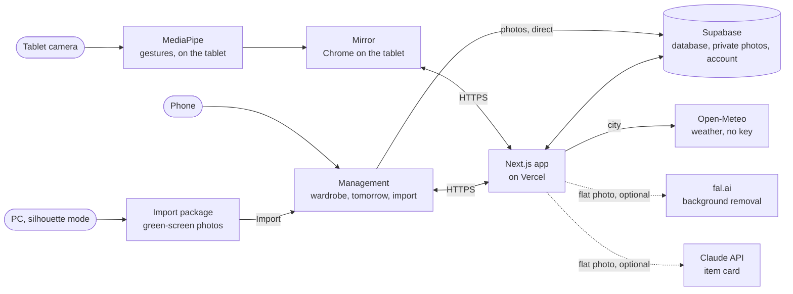

# 🪞 Mon Dressing — the mirror that picks your outfit

*[Version française](README.md)*

A smart mirror that suggests **today's outfit, based on the weather**, every morning, put together from
**your own clothes**. An Android tablet hidden behind a two-way mirror shows the outfit; you change it
**with arm gestures**, no controller and no touch, and you accept it with a thumbs-up. Your **phone**
manages the wardrobe: add a piece, mark it as in the wash, prepare tomorrow's outfit.

> Personal project shared as-is. The app runs online on free accounts (GitHub, Supabase, Vercel), in your
> name; all you add is your own photos. **The interface and the docs are in French.** The tablet behind a
> real mirror is still being tested: see the known limitations below.

## ✨ Features

- 🌤️ **Today's outfit, based on the weather**: warmth, rain, a jacket when the morning is cool, pieces in
  the wash left out; it avoids pieces worn in the last three days and favours colours that go together.
- 🙌 **Arm-gesture control**: hand in front of the chest then out to the side changes the top; above the
  head or down in front of the thighs changes the bottom; thumbs-up = yes, closed fist = no, V = jacket.
  Processed on the tablet by MediaPipe: **no image ever leaves it**.
- 🧍 **Silhouette mode**: your clothes, photographed worn against a green screen, are assembled into a
  single silhouette (the top from one photo, the bottom from another, the arms bent at the right place).
- 👕 **Simple mode**: cut-out photos from your phone, which the mirror stacks; free with an already cut-out
  PNG, or cut out for you by fal.ai.
- 🌙 **Prepare tomorrow**: in the evening, the mirror suggests tomorrow's outfit; in the morning, it is
  waiting for you.
- 📱 **The phone**: wardrobe by category, "in the wash" with one tap, 5 outfits for tomorrow, dismissed
  outfits, zip import.
- 🤖 **Automatic item card** (optional): Claude fills in the name, category, colour, warmth, styles and
  "ok pluie" (fine in the rain) of a photographed piece.
- 💤 **Presence-based sleep**: the screen only shows the time when nobody is there, and wakes up when you
  arrive.
- 🔒 **One account, yours**: sign-ups closed, photos in private buckets, no secret in the code.

## 🏗️ Architecture

> The camera image stops at MediaPipe: only landmarks (shoulders, hands) come out of it, and they stay on
> the tablet. Photos of your clothes go straight from the phone to your Supabase.

## 🧰 What you need

| What | Price | What it is for | Required |
|---|---|---|---|
| [GitHub](https://github.com) account | free | the Deploy button creates your copy of the repository there | yes |
| [Supabase](https://supabase.com) account, free plan | free | the database, the (private) photos, your account | yes |
| [Vercel](https://vercel.com) account, Hobby plan | free, personal non-commercial use | the app online, over HTTPS (the camera requires it) | yes |
| [Open-Meteo](https://open-meteo.com) | free, no account or key (non-commercial use) | weather and city search | automatic |
| [Claude API](https://platform.claude.com) key (Anthropic) | paid, prepaid credits | filling in the card of a flat photo | no |
| [fal.ai](https://fal.ai) key | paid, about $0.018 per image | cutting out a flat photo | no |
| Android tablet with a **front camera** | | the mirror (designed for 800×1280 in portrait) | yes |
| Two-way mirror + mount | | see [docs/materiel.md](docs/materiel.md) | yes |
| Phone | | managing the wardrobe | yes (or the PC's browser) |
| PC (Windows tested) | | cutting out a photo for free and adding it from its browser; the simple zip; silhouette mode; trying the app | for silhouette mode; recommended for the free simple mode |

## 👕 Two ways to add your clothes

| | Simple mode | Silhouette mode |
|---|---|---|
| On the mirror | the outfit's pieces **stacked** (jacket, top, bottom) | the outfit **assembled on you**, as one silhouette |
| You need | the phone, or the PC's browser | a green screen, a camera on a tripod, a PC |
| The photos | one flat photo per piece, **cut out**: a PNG with a transparent background (free; the safest way is to cut it out on the PC and add it from the PC's browser), or an ordinary photo cut out by fal.ai (paid); or a zip of PNGs prepared on the PC | one **worn** photo per piece, always in the same spot, then `INSTALLER_PHOTOS.bat` and a single command that builds the package |
| License | nothing special | the clothing parser it uses allows **research or evaluation only** ([details](THIRD_PARTY_NOTICES.md#third-party-notices-english)) |
| The guide (in French) | [docs/photos-simple.md](docs/photos-simple.md) | [docs/photos-silhouette.md](docs/photos-silhouette.md) |

Both modes mix: an outfit where one piece has no worn photo is shown as stacked pieces.

## 🚀 Quick install

Nothing to install on your PC. The order matters.

1. **Supabase** ([docs/supabase.md](docs/supabase.md)): create a free project, paste the whole
   [`supabase/schema.sql`](supabase/schema.sql) (**Copy raw file** button) into the **SQL Editor** and **Run**
   (confirm the "destructive" warning if it shows up: nothing is deleted), close sign-ups, create
   your account with a **password** and **Auto Confirm User**. Note three values: the project URL, the
   **Publishable** key (`sb_publishable_…`) and your account's **UID**.
2. **Vercel** ([docs/vercel.md](docs/vercel.md)): click the button, sign in with GitHub, authorize
   Vercel's GitHub app and keep the suggested name for your copy of the repository (private is fine), paste
   the three values, **Deploy**.

   [](https://vercel.com/new/clone?repository-url=https%3A%2F%2Fgithub.com%2Fsosoj92%2Fmiroir-dressing-intelligent&project-name=miroir-dressing&repository-name=miroir-dressing-intelligent&env=NEXT_PUBLIC_SUPABASE_URL,NEXT_PUBLIC_SUPABASE_PUBLISHABLE_KEY,ALLOWED_USER_ID&envDescription=The%203%20values%20from%20your%20Supabase%20project%20%28URL%2C%20Publishable%20key%2C%20account%20UID%29.&envLink=https%3A%2F%2Fgithub.com%2Fsosoj92%2Fmiroir-dressing-intelligent%2Fblob%2Fmain%2Fdocs%2Fsupabase.md%235-relever-les-trois-valeurs)
3. **Check**: `https://<project>.vercel.app/api/health` must say `"supabase":"configurée"` and
   `"ALLOWED_USER_ID":"définie"` ("configured", "set").
4. **Back in Supabase**: **Authentication** > **URL Configuration**, Site URL =
   `https://<project>.vercel.app`, and `https://<project>.vercel.app/auth/callback` in the Redirect URLs.
5. **Phone** ([docs/telephone.md](docs/telephone.md)): open `https://<project>.vercel.app/connexion`, sign
   in, then **Réglages** (Settings) > your city.
6. **Your clothes**: [simple mode](docs/photos-simple.md) or [silhouette mode](docs/photos-silhouette.md).
7. **Tablet** ([docs/tablette.md](docs/tablette.md)): open the address in Chrome, **Se connecter** (Sign
   in), camera **Allow**, screen always on; then mount it behind the mirror
   ([docs/materiel.md](docs/materiel.md)).
8. *(Optional)* Add `ANTHROPIC_API_KEY` and `FAL_KEY` in Vercel > **Settings** > **Environment
   Variables**, then **Redeploy** ([docs/vercel.md](docs/vercel.md#4-les-clés-facultatives-payantes)).

**After any variable change in Vercel: Redeploy.** A problem? [docs/depannage.md](docs/depannage.md).

## 🤝 Get help from an AI (for free)

**To INSTALL** (no knowledge required): open any free chatbot ([Claude.ai](https://claude.ai),
[ChatGPT](https://chat.openai.com), [Gemini](https://gemini.google.com)), paste the content of
**[INSTALL_WITH_AI.en.md](INSTALL_WITH_AI.en.md)**, and let it guide you, one step at a time.

**To CHANGE the code**: any coding assistant; give it [AGENTS.md](AGENTS.md), which sums up the project's
rules (secrets, design, tests).

## 🙌 The gestures

Stand 1.5 to 2 m away, facing the mirror. Every scroll starts with your **hand in front of your chest**.

| To | Gesture | Fallback key |
|---|---|---|
| Next / previous top | hand in front of the chest, then out to the side, to your right / to your left | → / ← |
| Next bottom | hand in front of the chest, then above your head | ↑ |
| Previous bottom | hand in front of the chest, then down in front of your thighs | ↓ |
| Next jacket | V sign held 1 s | V |
| Yes (keep the outfit) | thumbs-up held 1 s | Enter |
| No (dismiss what you see) | closed fist held 1 s | Backspace |
| Start over | from the phone | R, twice |
| Nothing | arms resting along your body | |

Details, tuning with `?gestures=debug`, and a webcam demo page: [docs/gestes.md](docs/gestes.md).

## 💻 Try it on your PC

Open your online app in Chrome on the PC: the keyboard does everything (arrows, V, Enter, Backspace), and
a webcam lets you try the gestures. To see the tablet screen: **F12** > device mode **800 × 1280**. To run
everything locally (Node 22.12+, `npm ci`, `npm run dev`): [docs/essayer-sur-pc.md](docs/essayer-sur-pc.md).

## 📚 Documentation (in French)

| Topic | Guide |
|---|---|
| Hardware, mounting, what is tested | [docs/materiel.md](docs/materiel.md) |
| Supabase step by step | [docs/supabase.md](docs/supabase.md) |
| Vercel, variables, optional keys | [docs/vercel.md](docs/vercel.md) |
| The tablet (sign-in, camera, full screen, kiosk) | [docs/tablette.md](docs/tablette.md) |
| The phone | [docs/telephone.md](docs/telephone.md) |
| Simple mode (cut-out PNG, fal.ai, simple zip) | [docs/photos-simple.md](docs/photos-simple.md) |
| Silhouette mode (green screen, PC) | [docs/photos-silhouette.md](docs/photos-silhouette.md) |
| The gestures | [docs/gestes.md](docs/gestes.md) |
| Try it on your PC | [docs/essayer-sur-pc.md](docs/essayer-sur-pc.md) |
| Troubleshooting | [docs/depannage.md](docs/depannage.md) |
| For developers | [docs/developpeurs.md](docs/developpeurs.md) |
| Design rules, screen by screen | [docs/conception.md](docs/conception.md) |

## ⚠️ Known limitations

- **French interface only** (dates, weather in °C, item cards written by Claude in French). No translation
  yet.
- **One account** per installation, and a layout designed for a portrait tablet (800×1280).
- **The tablet behind a real mirror is still being tested**: gesture thresholds, brightness, heat and
  gesture-engine speed remain to be measured on site.
- **Kiosk mode is set up in Android**: the app is not installable, has no offline cache and does not keep
  the screen on by itself; coming back after a reboot needs a launcher
  ([docs/tablette.md](docs/tablette.md#4-plein-écran-et-retour-après-un-redémarrage)).
- **Supabase free plan**: a project with little activity for 7 days is paused. A tablet that stays on
  keeps it active; after a long break, **Resume project** in Supabase (restorable for a year).
- **Cut-out PNG mode**: not yet tried with the gallery of a real iPhone or Android phone.
- **Silhouette mode**: tested on Windows only; planned but untested on Apple Silicon Macs with macOS 14 or
  newer and on Linux x86_64 or arm64 with glibc 2.28 or newer; for research or evaluation only (parser
  license).
- **Open-Meteo**: the free API is for non-commercial use, and its call limits may kick in earlier from
  Vercel; the mirror then shows "Météo indisponible" (weather unavailable).

## 🔒 Privacy

- **The camera never leaves the device.** Frames are processed on the tablet, never sent, saved or shown,
  not even in debug mode. No video of a person in the repository or in the tests.
- **Your photos stay yours**: in your Supabase's private buckets, shown through time-limited signed URLs.
  The silhouette mode's worn photos are prepared on your PC, offline.
- **What leaves, and only if you set it up**: a flat photo to fal.ai (cut-out) and to Claude (item card),
  server-side; your city to Open-Meteo. Nothing else.
- **No secret in the code**: your keys live in Vercel (or in `.env.local`, never committed).
  `npm run check:secrets` looks, before every commit, for keys, the values of your `.env.local`, and any
  photo, archive or personal fixture in the files git would take. Keep your photos in a folder **outside**
  the project folder.

## 📜 Third-party licenses

The gesture models (MediaPipe, Google), the silhouette mode's parser (FASHN Human Parser, NVIDIA SegFormer
license, research or evaluation only), the YuNet face detector and the weather data each have their own
license: [THIRD_PARTY_NOTICES.md](THIRD_PARTY_NOTICES.md#third-party-notices-english). None of these files
is in the repository: they are downloaded from their source at install time.

Weather data by [Open-Meteo.com](https://open-meteo.com/), licensed under
[CC BY 4.0](https://creativecommons.org/licenses/by/4.0/).

## 🤝 Contributing

Issues and PRs welcome, especially test reports from a real tablet behind a real mirror. Read
[CONTRIBUTING.md](CONTRIBUTING.md) (in French); for a security issue, [SECURITY.md](SECURITY.md). Never
commit a key, or a photo of a person.

## 📄 License

MIT — see [LICENSE](LICENSE).
