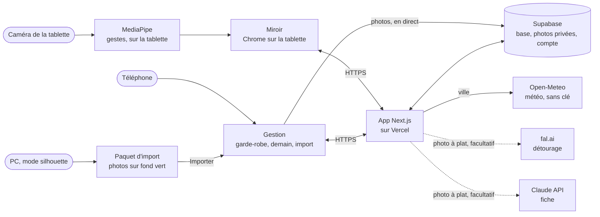

# 🪞 Mon Dressing — le miroir qui choisit ta tenue

*[English version](README.en.md)*

Un miroir connecté qui te propose chaque matin **la tenue du jour, selon la météo**, assemblée à partir de
**tes propres vêtements**. Une tablette Android cachée derrière un miroir sans tain affiche la tenue ; tu la
changes **d'un geste des bras**, sans manette ni tactile, tu la valides d'un pouce levé. Ton **téléphone**
gère la garde-robe : ajouter une pièce, la marquer au sale, préparer la tenue de demain.

> Projet perso partagé tel quel. L'app tourne en ligne sur des comptes gratuits (GitHub, Supabase, Vercel),
> à ton nom ; tu n'as qu'à y mettre tes propres photos. Interface en français. La tablette derrière un vrai
> miroir est encore en test : voir les limites connues, plus bas.

## ✨ Fonctionnalités

- 🌤️ **La tenue du jour selon la météo** : chaleur, pluie, veste quand il fait frais le matin, pièces au
  sale écartées ; elle évite de remettre une pièce portée ces trois derniers jours et favorise les couleurs
  qui vont ensemble.
- 🙌 **Commande aux gestes des bras** : la main devant la poitrine puis sur le côté change le haut, au-dessus
  de la tête ou devant les cuisses change le bas ; pouce levé = oui, poing fermé = non, V = veste. Analysé
  sur la tablette par MediaPipe : **aucune image ne sort**.
- 🧍 **Mode silhouette** : tes vêtements photographiés portés sur fond vert sont assemblés en une seule
  silhouette (le haut d'une photo, le bas d'une autre, les bras pliés au bon endroit).
- 👕 **Mode simple** : des photos détourées depuis le téléphone, que le miroir empile ; gratuit avec un PNG
  déjà détouré, ou détouré pour toi par fal.ai.
- 🌙 **Préparer demain** : le soir, le miroir propose la tenue du lendemain ; le matin, elle t'attend.
- 📱 **Le téléphone** : garde-robe par catégorie, « au sale » d'un toucher, 5 tenues pour demain, tenues
  écartées, import d'un zip.
- 🤖 **Fiche automatique** (facultatif) : Claude remplit le nom, la catégorie, la couleur, la chaleur, les
  styles et « ok pluie » d'une pièce photographiée.
- 💤 **Veille par présence** : l'écran n'affiche plus que l'heure quand personne n'est là, et se réveille
  quand tu arrives.
- 🔒 **Un seul compte, le tien** : inscriptions fermées, photos dans des dossiers privés, aucun secret dans
  le code.

## 🏗️ Architecture

> L'image de la caméra s'arrête à MediaPipe : seuls des repères (épaules, mains) en sortent, et ils
> restent dans la tablette. Les photos de tes vêtements vont directement du téléphone à ton Supabase.

## 🧰 Ce qu'il te faut

| Quoi | Prix | À quoi ça sert | Obligatoire |
|---|---|---|---|
| Compte [GitHub](https://github.com) | gratuit | le bouton Deploy y crée ta copie du dépôt | oui |
| Compte [Supabase](https://supabase.com), plan gratuit | gratuit | la base, les photos (privées), ton compte | oui |
| Compte [Vercel](https://vercel.com), plan Hobby | gratuit, usage perso non commercial | l'app en ligne, en HTTPS (la caméra l'exige) | oui |
| [Open-Meteo](https://open-meteo.com) | gratuit, sans compte ni clé (usage non commercial) | la météo et la recherche de ville | automatique |
| Clé [Claude API](https://platform.claude.com) (Anthropic) | payant, crédits prépayés | remplir la fiche d'une photo à plat | non |
| Clé [fal.ai](https://fal.ai) | payant, environ 0,018 $ l'image | détourer une photo à plat | non |
| Tablette Android avec **caméra frontale** | | le miroir (pensé pour 800×1280 en portrait) | oui |
| Miroir sans tain + fixation | | voir [docs/materiel.md](docs/materiel.md) | oui |
| Téléphone | | gérer la garde-robe | oui (ou le navigateur du PC) |
| PC (Windows testé) | | détourer gratuitement une photo et l'ajouter depuis son navigateur ; le zip simple ; le mode silhouette ; essayer l'app | pour le mode silhouette ; conseillé pour le mode simple gratuit |

## 👕 Deux façons d'ajouter tes vêtements

| | Mode simple | Mode silhouette |
|---|---|---|
| Sur le miroir | les pièces de la tenue **empilées** (veste, haut, bas) | la tenue **assemblée sur toi**, en une silhouette |
| Il te faut | le téléphone, ou le navigateur du PC | un fond vert, un appareil sur trépied, un PC |
| Les photos | une photo à plat par pièce, **détourée** : un PNG à fond transparent (gratuit ; le plus sûr est de le détourer sur le PC et de l'ajouter depuis le navigateur du PC), ou une photo ordinaire détourée par fal.ai (payant) ; ou un zip de PNG préparé sur le PC | une photo **portée** par pièce, toujours au même endroit, puis `INSTALLER_PHOTOS.bat` et une seule commande qui fabrique le paquet |
| Licence | rien de particulier | le parseur de vêtements utilisé n'autorise que la **recherche ou l'évaluation** ([détails](THIRD_PARTY_NOTICES.md#chaîne-photos-du-mode-silhouette-pc)) |
| Le guide | [docs/photos-simple.md](docs/photos-simple.md) | [docs/photos-silhouette.md](docs/photos-silhouette.md) |

Les deux modes se mélangent : une tenue dont une pièce n'a pas de photo portée s'affiche en pièces empilées.

## 🚀 Installation rapide

Sans rien installer sur ton PC. L'ordre compte.

1. **Supabase** ([docs/supabase.md](docs/supabase.md)) : crée un projet gratuit, colle tout
   [`supabase/schema.sql`](supabase/schema.sql) (bouton **Copy raw file**) dans le **SQL Editor** et **Run**
   (confirme l'avertissement « destructive » s'il apparaît : rien n'est effacé), ferme les inscriptions,
   crée ton compte avec un **mot de passe** et **Auto Confirm User**. Relève trois valeurs : l'URL du
   projet, la clé **Publishable** (`sb_publishable_…`) et l'**UID** de ton compte.
2. **Vercel** ([docs/vercel.md](docs/vercel.md)) : clique le bouton, connecte-toi avec GitHub, autorise
   l'app GitHub de Vercel et garde le nom proposé pour ta copie du dépôt (privée, c'est bien), colle les
   trois valeurs, **Deploy**.

   [](https://vercel.com/new/clone?repository-url=https%3A%2F%2Fgithub.com%2Fsosoj92%2Fmiroir-dressing-intelligent&project-name=miroir-dressing&repository-name=miroir-dressing-intelligent&env=NEXT_PUBLIC_SUPABASE_URL,NEXT_PUBLIC_SUPABASE_PUBLISHABLE_KEY,ALLOWED_USER_ID&envDescription=Les%203%20valeurs%20de%20ton%20projet%20Supabase%20%28URL%2C%20cl%C3%A9%20Publishable%2C%20UID%20de%20ton%20compte%29.&envLink=https%3A%2F%2Fgithub.com%2Fsosoj92%2Fmiroir-dressing-intelligent%2Fblob%2Fmain%2Fdocs%2Fsupabase.md%235-relever-les-trois-valeurs)
3. **Vérifie** : `https://<projet>.vercel.app/api/health` doit dire `"supabase":"configurée"` et
   `"ALLOWED_USER_ID":"définie"`.
4. **Retour dans Supabase** : **Authentication** > **URL Configuration**, Site URL =
   `https://<projet>.vercel.app`, et `https://<projet>.vercel.app/auth/callback` dans les Redirect URLs.
5. **Téléphone** ([docs/telephone.md](docs/telephone.md)) : ouvre `https://<projet>.vercel.app/connexion`,
   connecte-toi, puis **Réglages** > ta ville.
6. **Tes vêtements** : [mode simple](docs/photos-simple.md) ou [mode silhouette](docs/photos-silhouette.md).
7. **Tablette** ([docs/tablette.md](docs/tablette.md)) : ouvre l'adresse dans Chrome, **Se connecter**,
   caméra **Autoriser**, écran toujours allumé ; puis monte-la derrière le miroir
   ([docs/materiel.md](docs/materiel.md)).
8. *(Facultatif)* Ajoute `ANTHROPIC_API_KEY` et `FAL_KEY` dans Vercel > **Settings** > **Environment
   Variables**, puis **Redeploy** ([docs/vercel.md](docs/vercel.md#4-les-clés-facultatives-payantes)).

**Après tout changement de variable dans Vercel : Redeploy.** Un souci ? [docs/depannage.md](docs/depannage.md).

## 🤝 Se faire aider par une IA (gratuitement)

**Pour INSTALLER** (aucune connaissance requise) : ouvre n'importe quel chatbot gratuit
([Claude.ai](https://claude.ai), [ChatGPT](https://chat.openai.com), [Gemini](https://gemini.google.com)),
colle le contenu de **[INSTALL_WITH_AI.md](INSTALL_WITH_AI.md)**, et laisse-toi guider, une étape à la fois.

**Pour MODIFIER le code** : n'importe quel assistant de code ; donne-lui [AGENTS.md](AGENTS.md), qui
résume les règles du projet (secrets, design, tests).

## 🙌 Les gestes

Debout entre 1,5 et 2 m, de face. Chaque défilement part de la **main devant la poitrine**.

| Pour | Geste | Clavier de secours |
|---|---|---|
| Haut suivant / précédent | main devant la poitrine, puis sortie sur le côté, à ta droite / à ta gauche | → / ← |
| Bas suivant | main devant la poitrine, puis au-dessus de la tête | ↑ |
| Bas précédent | main devant la poitrine, puis vers le bas, devant les cuisses | ↓ |
| Veste suivante | signe V tenu 1 s | V |
| Oui (garder la tenue) | pouce levé tenu 1 s | Entrée |
| Non (écarter ce que tu vois) | poing fermé tenu 1 s | Retour arrière |
| Recommencer | depuis le téléphone | R, deux fois |
| Rien | bras au repos le long du corps | |

Le détail, le réglage avec `?gestures=debug` et une page de démonstration à la webcam :
[docs/gestes.md](docs/gestes.md).

## 💻 Essayer sur ton PC

Ouvre ton app en ligne dans Chrome sur le PC : le clavier fait tout (flèches, V, Entrée, Retour arrière),
et la webcam permet d'essayer les gestes. Pour voir l'écran de la tablette : **F12** > mode appareil
**800 × 1280**. Pour tout faire tourner en local (Node 22.12+, `npm ci`, `npm run dev`) :
[docs/essayer-sur-pc.md](docs/essayer-sur-pc.md).

## 📚 Documentation

| Sujet | Guide |
|---|---|
| Le matériel, le montage, ce qui est testé | [docs/materiel.md](docs/materiel.md) |
| Supabase pas à pas | [docs/supabase.md](docs/supabase.md) |
| Vercel, variables, clés facultatives | [docs/vercel.md](docs/vercel.md) |
| La tablette (connexion, caméra, plein écran, kiosque) | [docs/tablette.md](docs/tablette.md) |
| Le téléphone | [docs/telephone.md](docs/telephone.md) |
| Mode simple (PNG détouré, fal.ai, zip simple) | [docs/photos-simple.md](docs/photos-simple.md) |
| Mode silhouette (fond vert, PC) | [docs/photos-silhouette.md](docs/photos-silhouette.md) |
| Les gestes | [docs/gestes.md](docs/gestes.md) |
| Essayer sur ton PC | [docs/essayer-sur-pc.md](docs/essayer-sur-pc.md) |
| Dépannage | [docs/depannage.md](docs/depannage.md) |
| Pour les développeurs | [docs/developpeurs.md](docs/developpeurs.md) |
| Les règles de conception, écran par écran | [docs/conception.md](docs/conception.md) |

## ⚠️ Limites connues

- **Interface en français uniquement** (dates, météo en °C, fiches remplies par Claude en français). Pas de
  traduction pour l'instant.
- **Un seul compte** par installation, et une mise en page pensée pour une tablette en portrait
  (800×1280).
- **La tablette derrière un vrai miroir est encore en test** : les seuils des gestes, la luminosité, la
  chaleur et la vitesse du moteur des gestes restent à mesurer sur place.
- **Mode kiosque à régler dans Android** : l'app n'est pas installable, n'a pas de cache hors ligne et ne
  garde pas l'écran allumé d'elle-même ; le retour après un redémarrage demande un lanceur
  ([docs/tablette.md](docs/tablette.md#4-plein-écran-et-retour-après-un-redémarrage)).
- **Plan gratuit de Supabase** : un projet avec peu d'activité pendant 7 jours est mis en pause. La tablette
  allumée le garde actif ; après un long arrêt, **Resume project** dans Supabase (restaurable pendant un
  an).
- **Mode PNG détouré** : pas encore essayé avec la galerie d'un vrai iPhone ou Android.
- **Mode silhouette** : testé sous Windows seulement ; prévu, mais non testé, sur Mac Apple Silicon sous
  macOS 14 ou plus récent et sur Linux x86_64 ou arm64 avec glibc 2.28 ou plus récent ; réservé à la
  recherche ou à l'évaluation (licence du parseur).
- **Open-Meteo** : l'API gratuite est réservée à un usage non commercial, et ses limites d'appels peuvent
  tomber plus tôt depuis Vercel ; le miroir affiche alors « Météo indisponible ».

## 🔒 Confidentialité

- **La caméra ne quitte jamais l'appareil.** Les images sont analysées sur la tablette, jamais envoyées,
  enregistrées ni affichées, même en mode debug. Aucune vidéo de personne dans le dépôt ni dans les tests.
- **Tes photos restent chez toi** : dans les dossiers privés de ton Supabase, affichées par des adresses
  signées à durée limitée. Les photos portées du mode silhouette sont préparées sur ton PC, hors ligne.
- **Ce qui sort, et seulement si tu le règles** : une photo à plat vers fal.ai (détourage) et vers Claude
  (fiche), côté serveur ; ta ville vers Open-Meteo. Rien d'autre.
- **Aucun secret dans le code** : tes clés vivent dans Vercel (ou dans `.env.local`, jamais commité).
  `npm run check:secrets` cherche, avant chaque commit, des clés, les valeurs de ton `.env.local`, et toute
  photo, archive ou fixture personnelle dans les fichiers que git prendrait. Garde tes photos dans un
  dossier **en dehors** du dossier du projet.

## 📜 Licences tierces

Les modèles de gestes (MediaPipe, Google), le parseur du mode silhouette (FASHN Human Parser, licence
NVIDIA SegFormer, recherche ou évaluation seulement), le détecteur de visage YuNet et les données météo ont
chacun leur licence : [THIRD_PARTY_NOTICES.md](THIRD_PARTY_NOTICES.md). Aucun de ces fichiers n'est dans
le dépôt : ils sont téléchargés depuis leur source à l'installation.

Weather data by [Open-Meteo.com](https://open-meteo.com/), sous licence
[CC BY 4.0](https://creativecommons.org/licenses/by/4.0/).

## 🤝 Contribuer

Issues et PR bienvenues, surtout des retours d'essai sur une vraie tablette derrière un vrai miroir. Lis
[CONTRIBUTING.md](CONTRIBUTING.md) ; pour une faille de sécurité, [SECURITY.md](SECURITY.md). Ne commite
jamais de clé, ni de photo de personne.

## 📄 Licence

MIT — voir [LICENSE](LICENSE).
